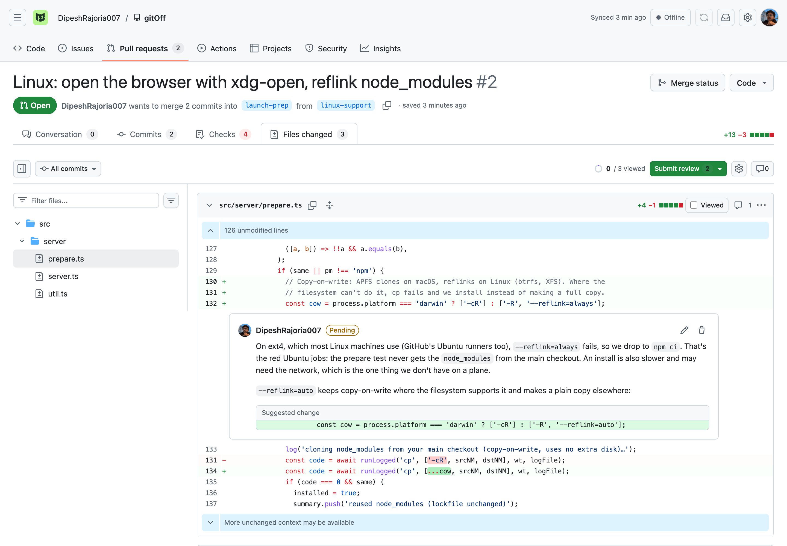
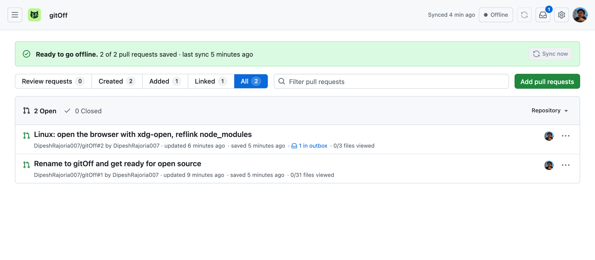
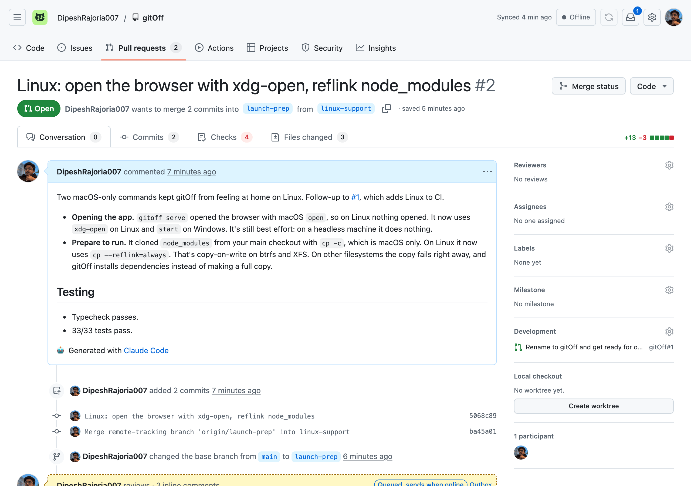
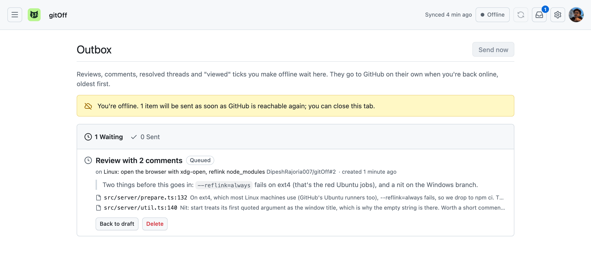
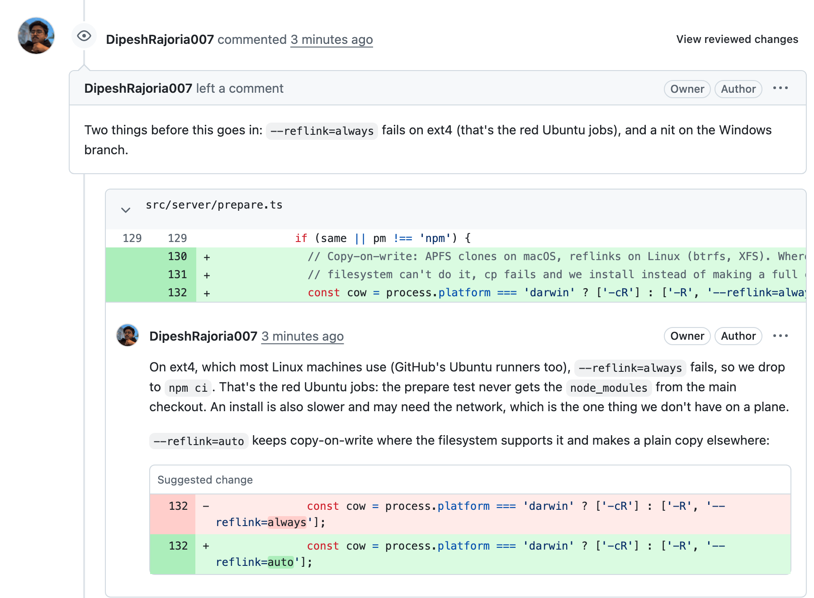

<p align="center"></p>

<h1 align="center">gitOff</h1>

<p align="center">
  <b>Review GitHub pull requests with no internet.</b><br>
  Cache your PRs before the flight, review them in a GitHub-style UI on the plane,<br>and your comments post themselves when you land.
</p>

<p align="center">
  <a href="https://github.com/DipeshRajoria007/gitOff/actions/workflows/ci.yml"></a>
  <a href="LICENSE"></a>
  
</p>

<p align="center">
  <picture>
    <source media="(prefers-color-scheme: dark)" srcset="docs/screenshots/files-dark.png">
    
  </picture>
</p>

gitOff is a small app that runs on your machine. While you're online it downloads everything a review needs: the description, conversation, review threads, commits, checks, diffs, images and screen recordings, linked PRs and Jira tickets. It also checks the branch out as a git worktree. Offline, you review the way you do on github.com. Comments, suggestions, approvals, resolved threads and "viewed" ticks wait in an outbox and go to GitHub by themselves once you're back online.

## Features

- **The whole pull request, offline.** Conversation, review threads, commits, checks, full diffs with expandable context, images, screen recordings, linked PRs and Jira tickets.
- **A UI you already know.** Files changed with split and unified diffs, a file tree, "Viewed" ticks, suggestions, pending reviews and keyboard shortcuts, built with GitHub's own Primer components. Light and dark themes.
- **An outbox you can trust on bad networks.** Reviews are posted against the commit you actually reviewed. Approvals are held if new commits landed while you were offline. Nothing is posted twice and nothing is dropped.
- **The code, too.** Each PR you review gets a git worktree next to your clone. Open it in Cursor or VS Code. **Prepare to run** copies your `.env` files and installs dependencies so you can run the branch on the plane.
- **Local and private.** It listens on 127.0.0.1 only, borrows the login of your GitHub CLI, stores no tokens and has no telemetry.

## Quick start

You need Node 20.19 or newer, git, and the [GitHub CLI](https://cli.github.com) logged in (`gh auth login`). Works on macOS and Linux.

```bash
git clone https://github.com/DipeshRajoria007/gitOff.git
cd gitOff
npm install
npm run build        # builds the web UI
npm link             # adds the `gitoff` command (undo: npm unlink -g gitoff)
gitoff serve         # starts the app at http://localhost:4777 and opens it
```

Press **Sync now** in the app. It downloads every open PR waiting for your review and your own PRs from the last week. Paste any other PR link into **Add pull requests**.

Keep `gitoff serve` running so it can send your outbox when the connection comes back. On macOS, `gitoff service install` starts it at login instead (a LaunchAgent; `gitoff service uninstall` removes it, `--dry-run` shows what it would write). On Linux the same command prints a systemd user unit.

## A review, start to finish

These screenshots are from a real review of [#2](https://github.com/DipeshRajoria007/gitOff/pull/2) in this repository. It was written with gitOff in offline mode and sent by it afterwards.

**Before you lose signal**, the dashboard tells you when everything is saved.



**Offline**, a pull request looks and works the way it does on github.com: description, timeline, commits, checks and the full diff.



When you submit a review, it waits in the outbox.



**Back online**, the outbox sends itself. Here's the same review on github.com, with each comment on its line and the suggestion intact:



## Before you lose connection

1. Open http://localhost:4777 and press **Sync now**. That pulls:
   - every open PR where your review is requested,
   - your own PRs updated in the last 7 days (change this in Settings),
   - anything you pasted into **Add pull requests**,
   - open PRs linked from those PRs' descriptions (for example the matching backend PR),
   - Jira tickets mentioned in the title, branch, description or commits (needs `gitoff jira login` once).
2. Check that the dashboard says **Ready to go offline**. It lists anything that failed to download.
3. To run a PR's code offline, open the PR and use **Prepare to run** (⋯ menu or sidebar). It copies your git-ignored `.env*` files from your main checkout and installs dependencies. If the lockfile matches your main checkout, it copies `node_modules` from there instead of installing, copy-on-write on APFS, btrfs and XFS, so it takes no extra disk.

Auto-sync also runs every 15 minutes while you're online, so the cache is usually fresh anyway.

## Reviewing offline

- **Files changed** works like GitHub: split or unified, hide whitespace, file tree, "N unmodified lines" expanders, per-commit and "changes since your last review" views. Diffs are computed locally with git, so expanding context works offline too.
- Hover a line and click **+** to comment. Drag to select several lines. **Suggest change** inserts a suggestion block. **Start a review** builds a pending review; **Add single comment** sends just that comment.
- Reply to threads, resolve or unresolve them, tick **Viewed** (`v`), and move between files with `j` and `k`.
- **Review changes** submits a comment, an approval or a change request. Offline, it goes to the **Outbox**.
- **Open in Cursor** opens the PR's worktree (`~/code/<repo>-review-<number>`, next to your clone). The file icon in a file's header opens that file at the changed line.

## What happens when you're back online

The app checks for a connection every 15 seconds while offline. When it can reach GitHub it sends the outbox first, then refreshes your PRs.

- A review is created against the commit you actually reviewed, so your line comments land on the right lines even if new commits were pushed meanwhile. GitHub marks them outdated if those lines changed.
- **An approval is held** if new commits landed after you reviewed. The outbox asks you to approve anyway, send it as a comment, or put it back into a draft. The same happens if the commit you reviewed was force-pushed away.
- If GitHub can't place a comment on a line (outside the diff, or the file changed), it's posted as a file comment that quotes the code. If even that fails, it goes into the review summary. Nothing is dropped.
- Sending is safe on bad networks. Every comment carries an invisible marker (`<!-- ogh:… -->`), so if a response gets lost, the next attempt sees what already reached GitHub and doesn't post it twice. Rate limits and server errors are retried later.
- Reviews for the same PR go out one at a time, in order. A later review waits while an earlier one is held for your OK.
- If you had started a review on github.com, your offline comments are added to that pending review. Single comments never touch it.
- A "viewed" tick isn't sent for a file that changed after you looked at it.

Want to try it without turning off Wi-Fi? `GITOFF_OFFLINE=1 gitoff serve` never contacts GitHub, so everything you submit stays in the outbox until you restart it normally.

## Privacy and security

- The server listens on 127.0.0.1 and only answers requests addressed to localhost. Requests that change anything need a custom header, so other websites you visit can't drive it.
- It asks the GitHub CLI for a token (`gh auth token`) when it needs one and never writes it to disk. Git fetches use the same login over HTTPS.
- It only talks to GitHub, to the hosts of images and videos in the PRs you cache, and to your Jira site if you connect one. There is no analytics or telemetry.
- PR content is sanitized before it's shown. Files and media that come from a PR are served under a sandboxing Content-Security-Policy, and the app itself runs under a strict one.

## Jira

`gitoff jira login` (or Settings → Jira) asks for your Atlassian email and an [API token](https://id.atlassian.com/manage-profile/security/api-tokens). On macOS the token goes into the Keychain (service `gitoff-jira`), not a file. On Linux, set `JIRA_API_TOKEN` (and optionally `JIRA_EMAIL`) in the environment that runs `gitoff serve`. Tickets are found from links to `*.atlassian.net/browse/KEY-123`. Bare keys like `PROJ-123` in the PR title, branch or commits count too, once gitOff has seen a link to that Jira project.

## Commands

| command | |
|---|---|
| `gitoff serve [--port N] [--no-open]` | run the app and background sync |
| `gitoff add <url>…` | cache PRs (also `owner/repo#123`) |
| `gitoff sync [--full]` | send the outbox, refresh the queue and PRs (`--full` re-downloads everything) |
| `gitoff status` | what's cached, drafts, outbox |
| `gitoff open <pr> [file[:line]]` | open the worktree in Cursor or VS Code |
| `gitoff prepare <pr>` | copy `.env` files and install dependencies in the worktree |
| `gitoff jira login` | connect Jira |
| `gitoff doctor` | check gh auth, git, editor, clones, Jira |
| `gitoff service install\|uninstall [--dry-run]` | start at login (macOS), or print a systemd unit (Linux) |

`ogh`, the project's original name, still works as an alias for `gitoff`.

## Where things live

- `~/.gitoff/`: snapshots, media, the outbox, settings and logs. Delete it to start over. Set `GITOFF_HOME` to put it somewhere else. (Installs from before the rename keep using `~/.offline-github`.)
- PR refs are fetched into your existing clones under `refs/ogh/pr/<n>/*`. Your branches and `origin/*` aren't touched.
- Clones are found under `~/code` (or `~/src`, `~/dev`, `~/projects` and similar if there's no `~/code`; change it in Settings). Repos without a local clone get a bare clone inside the data folder.
- Worktrees are created next to the matching clone, detached at the PR head. A worktree is only moved to a new head when it has no uncommitted changes and no commits of yours. Your own PRs get a worktree only when you ask for one.
- Cleanup: a PR that's closed or no longer in your queue, with no activity for a week and nothing unsent, is removed along with its worktree (only if the worktree is clean).

## How it's built

- `src/server`: Node and TypeScript (run through `tsx`, no build step), a [Hono](https://hono.dev) HTTP server, GitHub GraphQL for snapshots and reviews, REST for single comments. State is plain JSON files.
- `web`: React, Vite, GitHub's [Primer](https://primer.style) components and design tokens, and [`@pierre/diffs`](https://www.npmjs.com/package/@pierre/diffs) for syntax-highlighted diffs. Everything is bundled locally, so the UI needs no network.
- `npm test` covers the outbox against a fake GitHub API (ordering, holds, fallbacks, lost responses, no double posts), diff parsing (renames, quoted and unicode paths, binary and generated files) and worktree safety.

## Known limits

- Reactions, editing or deleting comments already on GitHub, and merging aren't supported offline.
- CI logs aren't downloaded. The Checks tab shows each check's status as of the last sync.
- Line comments can be added on the "All changes" view, and on new-side lines in "Changes since your last review". Other views use line numbers GitHub can't map.
- Very large and generated files (lockfiles, `linguist-generated`) stay collapsed until you click **Load diff**, as on GitHub.
- Windows isn't tested. WSL should behave like Linux.

## Contributing

Issues and pull requests are welcome. `npm test` runs the tests and `npm run typecheck` checks types. For UI work, run `npm run dev:server` and `npm run dev:web` side by side and open http://localhost:5173.

## License

[MIT](LICENSE). gitOff is an independent project and isn't affiliated with or endorsed by GitHub.
